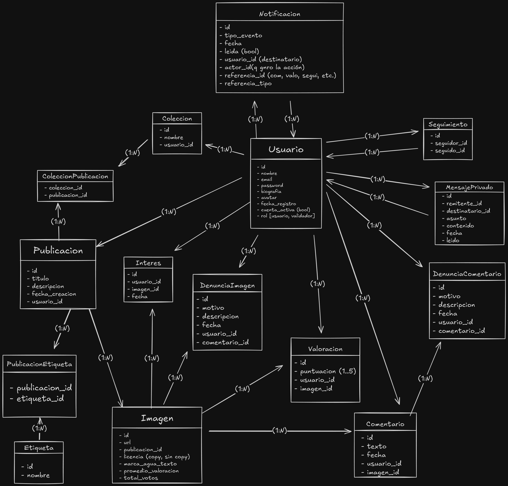

# Fotaza
> Proyecto Final Integrador de Programacion WEB II

Para hacer este readme utilicé esto: [Sintaxis](https://docs.github.com/es/get-started/writing-on-github/getting-started-with-writing-and-formatting-on-github/basic-writing-and-formatting-syntax)
#### La aplicación la voy a construir con:
* Model: Sequelize + PostgreSQL
* Vista: Pug -> para renderizados en el servidor.
* Controladores: Express, rutas y logicas en capas ej: (rutas -> controladores -> servicios -> modelos).

## Carpetas:
```
/config >(conexion db, variables de entorno)
/models >(sequelize)
/db >(inicialización db)
/controllers >(logica de modulo)
/services >(logica de negocio)
/seeders >(usuarios de prueba)
/routes >(definicion de rutas)
/views >(plantillas pug)
/public >(css, bs, imagenes)
/middlewares >(auth, roles, etc.)
/helpers >(funciones auxiliares)
```
  
## Estructura para la Base de Datos:
```
> Usuario [id, nombre, email, password_hash, biografía, avatar, fecha_registro, cuenta_activa (bool), rol (usuario, validador)] | El validador es un perfil especial
> Publicacion [id, titulo, descripcion, fecha_creacion, usuario_id] | Pertenece a un usuario
> Imagen [id, url, publicacion_id, licencia (con_copyright, sin_copyright), marca_agua_texto (opcional), promedio_valoracion, total_votos, comentarios_cerrados] | Varias imagenes por publicacion
> Etiqueta [id, nombre] | Tabla aux para publicacion
> PublicacionEtiqueta [publicacion_id, etiqueta_id] | Tabla intermedia
> Comentario [id, texto, fecha, usuario_id, imagen_id] | Pertenece a una imagen
> Valoracion [id, puntuacion (1..5), usuario_id, imagen_id] | Un usuario puede votar una sola vez por imagen
> DenunciaImagen [id, motivo, descripcion, fecha, usuario_id, imagen_id] | Una imagen puede tener varias denuncias de distintos usuarios.
> DenunciaComentario [id, motivo, descripcion, fecha, usuario_id, comentario_id] | Comentarios tambien denunciables.
> Seguimiento [id, seguimiento_id, seguido_id] | Un usuario sigue a otro, sin seguirse así mismo.
> Notificacion [id, tipo_evento, fecha, leida (bool), usuario_id (destinatario), actor_id (quien generó la acción), referencia_id (comentario, valoracion, seguimiento, etc.), referencia_tipo] | Gestor de notificaciones
> Coleccion [id, nombre, usuario_id] | Coleeciones personales
> ColeccionPublicacion [coleccion_id, publicacion_id] | Tabla intermedia
> MensajePrivado [id, remitente_id, destinatario_id, asunto, contenido, fecha, leido] | Para el contacto
> Interes [id, usuario_id, imagen_id, fecha] | Cuando un usuario marca "me interesa", vinculado a mensajeria.
```

## Diagrama ER

1.Contenido Principal
  * Usuario <-> Publicacion: (1:N)
    - 1 Usuario puede tener N(muchas) Publicaciones.
    - 1 Publicacion pertenece a 1 solo Usuario.
  * Publicacion <-> Imagen: (1:N)
    - 1 Publicacion puede contener N Imagenes.
    - 1 Imagen pertenece a 1 sola Publicación.
    
2.Clasificacion y Agrupación
  * Publicacion <-> Etiqueta: (N:M)
    - N Publicaciones puede tener M Etiquetas
    - Para el diagrama hay una tabla intermedia PublicacionEtiqueta (1 Publicacion -> N PublicacionEtiqueta; 1 Etiqueta -> N PublicacionEtiqueta).
  * Usuario <-> Coleccion: (1:N)
    - 1 Usuario puede crear N Colecciones.
    - 1 Colección pertenece a 1 solo Usuario.
  * Coleccion <-> Publicacion: (N:M)
    - N Colecciones pueden guardar M Publicaciones.
    - Para el diagrama hay una tabla intermedia ColeccionPublicacion (1 Coleccion -> N ColeccionPublicacion; 1 Publicacion -> ColeccionPublicacion).
    
3.Interacciones(Com, Val, Int.)
  * Usuario <-> Comentario: (1:N)
    - 1 Usuario puede escribir N Comentarios.
  * Imagen <-> Comentario: (1:N)
    - 1 Imagen puede recibir N Comentarios.
  * Usuario <-> Valoracion: (1:N)
    - 1 Usuario puede dejar N Valoraciones (likes/votos).
  * Imagen <-> Valoracion: (1:N)
    - 1 Imagen puede recibir N Valoraciones.
  * Usuario <-> Interes: (1:N)
    - 1 Usuario puede marcar N intereses.
  * Imagen <-> Interes: (1:N)
    - 1 Imagen puede recibir N marcas de interes.
    
4.Moderación
  * Usuario <-> DenunciaImagen: (1:N)
    - 1 Usuario puede realizar N Denuncias de Imagenes.
  * Imagen <-> DenunciaImagen: (1:N)
    - 1 Imagen puede recibir N Denuncias.
  * Usuario <-> DenunciaComentario: (1:N)
    - 1 Usuario puede realizar N Denuncias de comentarios.
  * Comentario <-> DenunciaComentario: (1:N)
    - 1 Comentario puede recibir N Denuncias.
    
5.Red Social y Mensajes
  * Usuario <-> Usuario: (N:M)
    - Un usuario sigue a muchos y es seguido por muchos.
    - Para el diagrama hay una tabla intermediaria Seguimiento (1 Usuario -> N Seguimiento (seguidor_id); 1 Usuario -> N Seguimiento (seguido_id)).
  * Usuario <-> Usuario: (N:M)
    - Un usuario envia mensajes a muchos y recibe de muchos.
    - Para el diagrama hay una tabla intermediaria MensajePrivado (1 Usuario -> N MensajePrivado (remitente_id); 1 Usuario -> N MensajePrivado (destinatario_id)).
    
6.Notificaciones
  * Usuario <-> Notificacion: (1:N)
    - 1 Usuario recibe N Notificaciones.
    - 1 Usuario genera N Notificaciones con acciones.


## Inicializacion del proyecto
> Paso a paso como cree todo:
```
mkdir fotaza
cd fotaza
npm init -y (acá usé el -y para omitir el asistente y crea el package.json por defecto).
```
> Paso siguiente instalo las dependencias que voy a utilizar:
```
npm install express sequelize pg pg-hstore pug multer cloudinary bcrypt express-session dotenv
```
> Y despues para el desarrollo:
```
npm install --save-dev nodemon sequelize-cli (el sequelize-cli me va a servir para automatizar las tareas con la bd)
```
> Creamos las carpetas:
```
fotaza/
├── config/
├── db/
├── seeders/
├── models/
├── controllers/
├── services/
├── routes/
├── views/
├── public/
│   ├── css/
│   └── js/
├── middlewares/
├── helpers/
├── .env.example
├── app.js
└── package.json
```
> Dentro del .env.example ponemos las variables de entorno
```
DB_HOST=localhost
DB_PORT=5432
DB_NAME=fotaza
DB_USER=emadupre
DB_PASSWORD=admin
SESSION_SECRET=proyecto_final_web
PORT=3001 (acá yo tuve que utilizar el puerto 3001 ya que en el puerto 3000 tengo el ADGuard configurado).
```
> Configuracion de Cloudinary en el .env.example (ahora es necesario para subir las imagenes)
Al momento de crear la cuenta en cloudinary nos proporciona el cloud name, api key y el api secret que no lo voy a poner acá porque a futuro este proyecto será publico y así cualquiera pueda tener su propia configuracion.
```
CLOUDINARY_CLOUD_NAME=tu_cloud_name
CLOUDINARY_API_KEY=tu_api_key
CLOUDINARY_API_SECRET=tu_api_secret
```
> Configuramos el Sequelize en config/database.js
```
const { Sequelize } = require('Sequelize');
require('dotenv').config();

const sequelize = new Sequelize(
  process.env.DB_NAME,
  process.env.DB_USER,
  process.env.DB_PASSWORD,
  {
    host: process.env.DB_HOST,
    port: process.env.DB_PORT,
    dialect: 'postgres',
    logging: false, // acá se que si quiero ver las consultas SQL se puede poner en **true**
  }
);

module.exports = sequelize;
```
## Instalación y ejecución

1. Clonar el repositorio:
  ```
  git clone https://github.com/emadupre/fotaza.git
  cd fotaza
  ```
2. Instalar dependencias:
  ```
  npm install
  ```
3. Configurar las variables de entorno:
  ```
  cp .env.example .env
  Editar .env con tus datos de PostgreSQL y Cloudinary
  ```
4. Crear la base de datos en PostgreSQL (si no existe):
  ```
  # Usando psql o DBeaver
  CREATE DATABASE fotaza;
  ```
5. Crear las tablas en la base de datos:
  ```
  npm run db:init
  ```
6. Cargar los seeders (Opcional)
  ```
  node seeders/seed.js
  ```
7. Iniciar la aplicación:
  ```
  npm start
  ```
8. Abrir en el navegador:
  ```
  http://localhost:3001
  ```
## Usuarios de prueba
>[!NOTE]
>Acá cree varios usuarios para que se pueda chequear si bien el rol del admin validador, otros usuarios para poder hacer aportes.

| Email | Contraseña | Rol |
|-------|------------|-----|
| validador@fotaza.com | 123456 | Validador |
| jose@fotaza.com | 123456 | Usuario |
| enzofet@fotaza.com | 123456 | Usuario |
| naib@fotaza.com | 123456 | Usuario |
| fer@fotaza.com | 123456 | Usuario |
| ema.dupre7@gmail.com | 123456 | Usuario |

## BackUp
>[!IMPORTANT]
>El archivo 'fotaza_backup.sql' tiene la estructura completa de la base de datos sumado a datos de prueba.

## Problemas y soluciones

### 1. Redirecciones con 'res.redirect('back')'
- **Problema:** Durante el desarrollo usé muchas veces el ('back'), lo cual al momento de correr el proyecto y redirigirme causaba el problema 'Can not GET /../back' porque en el navegador no siempre se envia el header 'Referer'.
- **Solución**: Fue sencillo, remplacé todos las redirecciones por rutas absolutas por ej: 'res.redirect('/publicacines/' + id);'.

### 2. Error en 'publicacion.addEtiquetas' porque no era una función.
- **Problema:** Surgió al momento de realizar las relaciones N:M, el nombre no me coincidia con lo que esperaba.
- **Solución:** Utilicé directamente la tabla intermedia 'PublicacionEtiqueta.create()', entonces, con eso me permite más control.

### 3. Nombres de archivo con 'undefined' al momento de subir las imanges
- **Problema:** Cuando creaba una publicación las imagenes se guardaban como 'comp-undefined' porque usaba mal el 'file.name' ya que no existe en multer. En lugar de 'file.filename'.
- **Solución:** Corregí nada más la referencia en el controlador a 'file.filename'.

### 4. Publicaciones propias me aparecían en 'De tus seguidos'
- **Problema:** Al momento de hacer la consulta no excluia al usuario entonces mostraba sus propias publicaciones en la sección.
- **Solución:** Tuve que corregir el array 'idsSeguidos' para eliminar el ID del usuario que está logueado.

### 5. Error en el login
- **Problema:** Al migrar la estructura en 'authController.js' pasé mal 'where: email' en lugar de 'where: { email }.
- **Solución:** Corregí la sintaxis nada ma´s para usar un objeto como pide Sequelize.

### 6. El botón "seguir" en el perfil propio
- **Problema:** El botón de seguir/dejar de seguir me lo mostraba por más de que sea mi perfil.
- **Solución:** Anidé los botones dentro de la condición 'if !esPropioPerfil' en la vista y listo.

### 7. Panel validador
- **Problema:** La consulta SQL con el having no me funcionaba ya que tenía 'HAVING COUNT(DISTINCT ...)' no funcionaba por Sequelize.
- **Solución:** Ya que no funcionaba por la forma en que Sequelize generaba la consulta utilicé una consulta nativa 'sequelize.query()' y así obtenía los IDs de las publicaciones con más de 3 denuncias de usuarios distintos.

### 8. Conexión a la base de datos de Render
- **Problema:** Al momento de desplegar en Render, la aplicación no podía conectarse a la base de datos. El error que me tiraba era getaddrinfo ENOTFOUND dpg-d8jkm01kh4rs73e8bqfg-a porque se usaba como el hostname interno sin el dominio completo.
- **Solución:** Utilicé el hostname externo completo (dpg-d8jkm01kh4rs73e8bqfg-a.oregon-postgres.render.com) en la variable DB_HOST del entorno de render, y se activó SSL en la configuración de Sequelize para la producción.

### 9. Error ENOENT al subir las imagenes en Render
- **Problema:** La aplicación seguía usando el multer.diskStorage y trataba de guardar archivos en la carpeta de uploads/, lo que no era compatible con Render. El error era  ENOENT: no such file or directory, open 'uploads/...'.
- **Solución:** Tuve que migrar el almacenamiento de las imagenes a Cloudinary. Cambié el diskStorage por memoryStorage y la subida se realiza directamente desde el buffer del archivo, eliminando la dependencia del sistema de archivos.

### 10. Error Invalid gravity in transformation en Cloudinary
- **Problema:** Al subir una imagen con la marca de agua, Cloudinary me devolvía el error ``` Invalid gravity in transformation: southeast ```.
- **Solución:** Tuve que corregir el valor de gravity en la transformación de Cloudinary, usando el ```'south_east'``` (con el guión bajo) en lugar del ```'southeast'``` que venía utilizando, porque es la sintaxis que utiliza Cloudinary.

### 11. Simplificación del procesamiento de imágenes
- **Problema:** Anteriormente usaba las librerias ```sharp``` y ```fs``` para comprimir y poner la marca de agua, lo que tenía que guardar archivos temporales en el proyecto y no era la mejor opción al momento de desplegar en Render.
- **Solución:** No renegué tanto y me fui directamente a Cloudinary por recomendación de un compañero, y la verdad que el codigo y configuración fue mucho más simple. Eliminé la dependencia ```sharp``` y las otras operaciones de lectura y escritura de archivos. Me ayudó bastante, ya que en Render era complicado.

### 12. Mostrar imágenes públicas a usuarios anónimos
- **Problema:** El requisito del TPI remarcaba que los usuarios no registrados podian ver las publicaciones sin copyright. Al principio el `home.pug` solo mostraba para loguearse/registrarse, pero no listaba ninguna imagen publica. Además, si un usuario anonimo intentaba acceder directamente a la url de una publicacion con copyright, podía verla sin restricción. Ahora eso ya no se puede.
- **Solución:** Modifiqué el `homeController.js` para que cuando no hay sesión, busque publicaciones activas que contengan imagenes sin licencia, es decir `sin_copyright` y las envia a la vista `publicacionesPublicas`. En el `home.pug`, dentro del bloque `else` agregué una sección que muestra estas imagenes con la vista previa. Tambien le agregue una validación en `verPublicacion` que sería el controlador que impide a la gente anonima ver una publicacion si alguna de las imagenes tiene copyright, devolviendo el error 403 con un mensaje explicativo.
